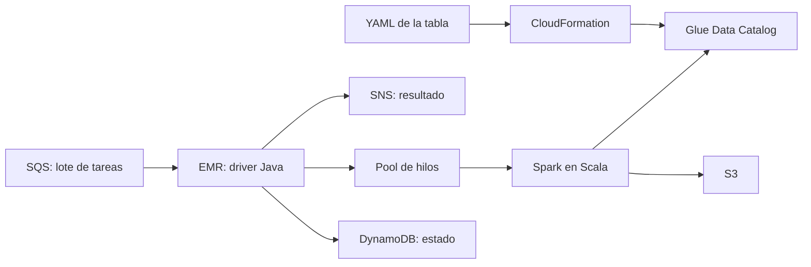
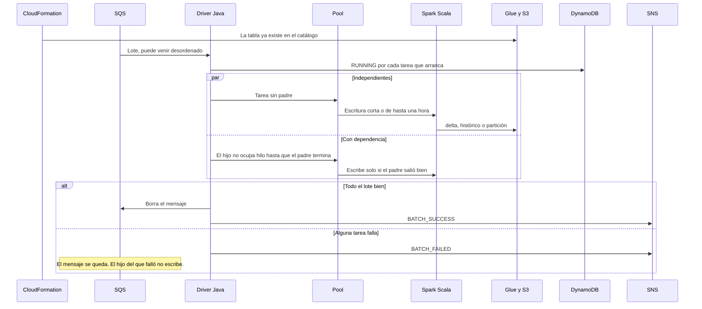
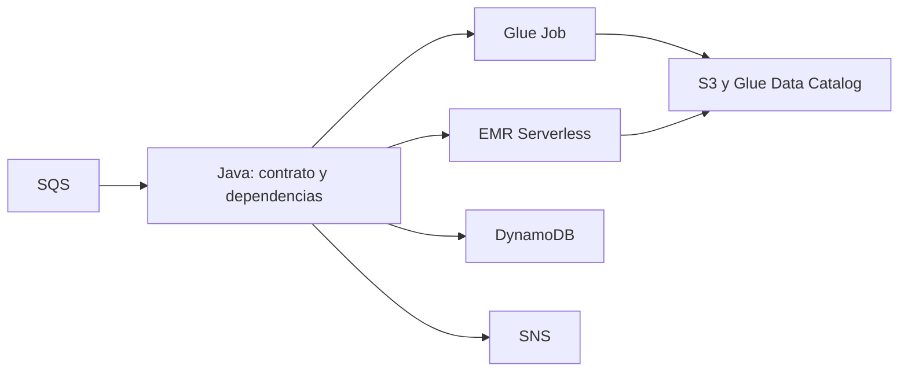
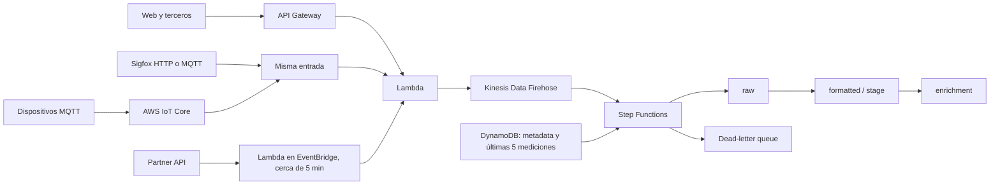
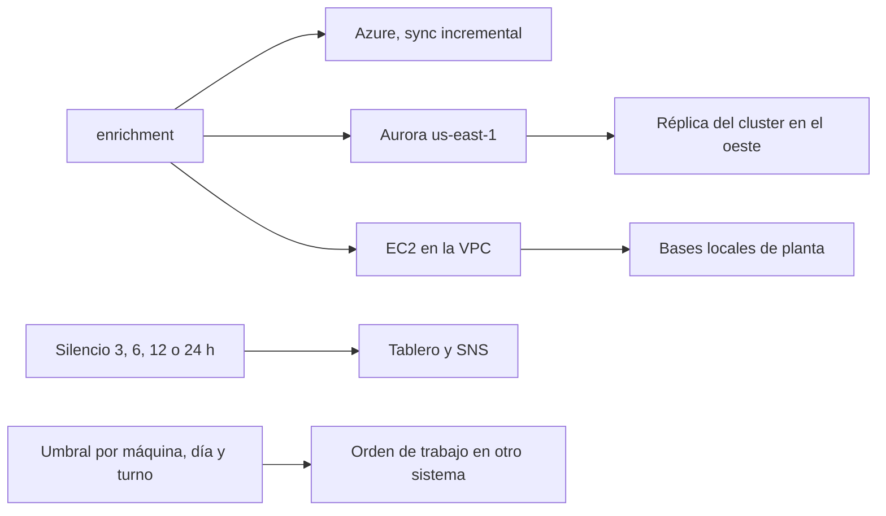

# Dos pipelines

Dos arquitecturas para enseñarlas y compartirlas. No son los repositorios originales: no hay ids de cuenta, ni credenciales, ni el código que corrió en producción.

1. Data lake en EMR, multi-cuenta.
2. GBC Connected, el ETL serverless de datos IoT de plantas de Grupo Bimbo. BBU (Bimbo Bakeries USA) era el siguiente rollout y no forma parte de este diseño.

La versión 1 es un solo sistema. La versión 2 es la evolución, cuando el cómputo sale del cluster encendido.

## Servicios de la versión 1



Cada tabla nueva entra por su YAML. El pipeline aplica un stack de CloudFormation y deja el schema en el catálogo de Glue, con los parámetros de las otras cuentas en el deploy, no en el archivo. Cuando llega trabajo, SQS trae el lote. El driver en Java decide el orden. Spark escribe en S3 y publica la tabla. DynamoDB guarda el estado. SNS avisa cómo terminó.

## Flujo de un lote, de inicio a fin



Una escritura de una hora mantiene el cluster ocupado. El reloj de inactividad no corre mientras el lote sigue vivo. Empieza cuando ya no hay lotes y la cola no trae trabajo.

## Versión 2, la evolución



El contrato de la tabla no cambia. Cambia quién corre Spark. Java sigue leyendo la cola, el estado y las dependencias, y deja de hospedar el clúster. Glue Jobs o EMR Serverless hacen la escritura y se apagan al terminar. Esta versión no es lo que operó el pipeline original.

## Qué hay en el código

`EmrOrchestrator` es la versión 1: un pool, padres antes que hijos aunque el lote llegue al revés, tareas sin padre en paralelo, borrado de la cola solo si el lote termina bien, estado en el catálogo y aviso por el notificador. `TableWriter` es el lugar del Spark. `IdleWatch` es el reloj del cluster.

`CloudNativeOrchestrator` es la versión 2. `ServerlessJobs.start` representa el job remoto. No hay reloj de cluster en ese proceso.

Los nombres de cuenta y los ARN se pasan al deploy. No viven en este repo.

## Correr

```bash
mvn test
```

## GBC Connected: datos IoT de planta

Grupo Bimbo. Llegaban producción y servicios (agua, energía, electricidad, masa, envolturas) por varias puertas. El trabajo era dejarlos en un esquema, por país, región, planta, línea, turno y máquina.



El poll existe porque ese partner a veces devolvía huecos o filas fuera de orden. DynamoDB no era el warehouse. Guardaba la metadata del dispositivo y las últimas cinco mediciones, para insertar un acumulado atrasado y recalcular el delta. La llave de la medición es device id y timestamp en milisegundos. Un lote de unas 60 filas podía traer un minuto que otra Lambda ya había procesado.

La misma petición podía correr dos veces entre API Gateway y Lambda. No recuerdo la causa. La escritura idempotente cae en el mismo ítem de DynamoDB. La cola FIFO también tenía un id de deduplicación. No recuerdo esa cadena.



Azure iba incremental por el cupo de conexiones. Las bases de planta no se alcanzaban desde la Lambda: el EC2 era el puente dentro de la VPC. El cluster de Aurora en Virginia se replicaba a uno en el oeste. No recuerdo si la tabla de DynamoDB del oeste iba por streams o por global table.

El tráfico de producción se quedaba en us-east-1. El stack del oeste ya estaba levantado, con su tabla, y esas Lambdas no corrían. El hostname único, si lo había, no estaba dentro de los dos stacks: estaría delante, en Route 53 o en CloudFront. No recuerdo cuál.

El deploy era CDK. Un push a GitLab aplicaba dos stacks de CloudFormation. El principal era us-east-1. El de espera era la región oeste.

Empezó en unos cinco dispositivos. Cada Lambda era un paso. Si uno fallaba, el paso anterior ya había dejado la lectura. La ingesta era seguida, cerca de una por segundo, así que el frío de Lambda dejó de ser el diseño.
