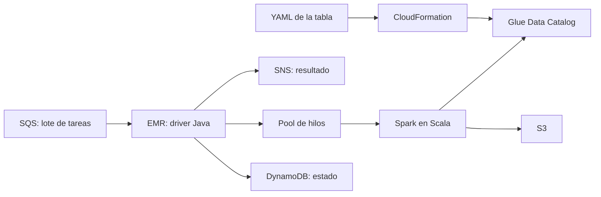
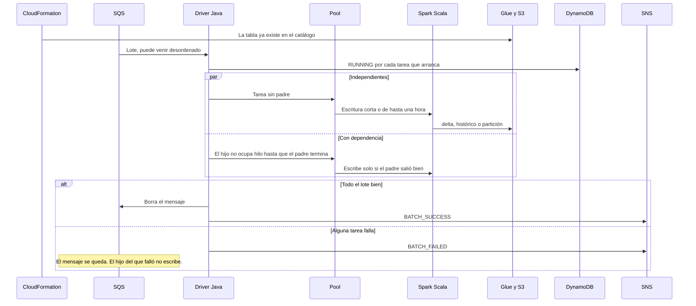
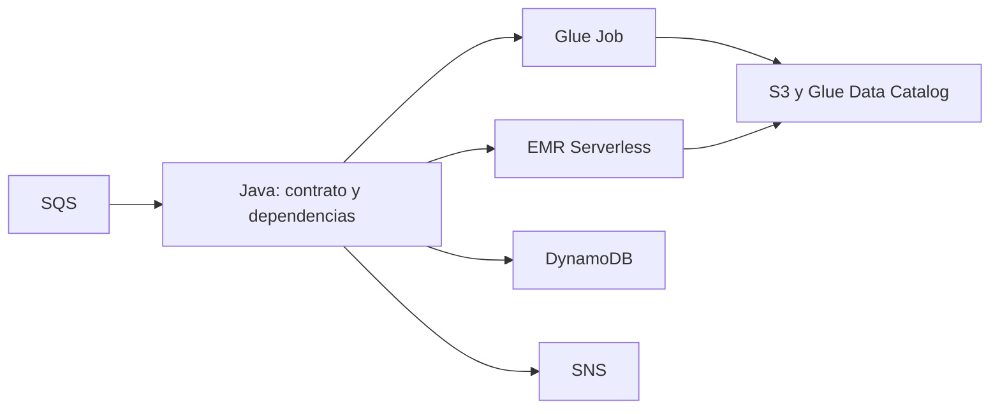

# Pipeline EMR, en dos versiones

Reconstrucción del diseño para estudiarlo y compartirlo. No es el repositorio original: no hay ids de cuenta, ni credenciales, ni el código Spark que corrió en el cluster.

La versión 1 es un solo sistema. La versión 2 es la evolución, cuando el cómputo sale del cluster encendido.

## Servicios de la versión 1



Cada tabla nueva entra por su YAML. El pipeline aplica un stack de CloudFormation y deja el schema en el catálogo de Glue, con los parámetros de las otras cuentas en el deploy, no en el archivo. Cuando llega trabajo, SQS trae el lote. El driver en Java decide el orden. Spark escribe en S3 y publica la tabla. DynamoDB guarda el estado. SNS avisa cómo terminó.

## Flujo de un lote, de inicio a fin



Una escritura de una hora mantiene el cluster ocupado. El reloj de inactividad no corre mientras el lote sigue vivo. Empieza cuando ya no hay lotes y la cola no trae trabajo.

## Versión 2, la evolución



El contrato de la tabla no cambia. Cambia quién corre Spark. Java sigue leyendo la cola, el estado y las dependencias, y deja de hospedar el clúster. Glue Jobs o EMR Serverless hacen la escritura y se apagan al terminar. Esta versión no es lo que operó el pipeline original.

## Qué hay en el código

`EmrOrchestrator` es la versión 1: un pool, padres antes que hijos aunque el lote llegue al revés, tareas sin padre en paralelo, borrado de la cola solo si el lote termina bien, estado en el catálogo y aviso por el notificador. `TableWriter` es el lugar del Spark. `IdleWatch` es el reloj del cluster.

`CloudNativeOrchestrator` es la versión 2. `ServerlessJobs.start` representa el job remoto. No hay reloj de cluster en ese proceso.

Los nombres de cuenta y los ARN se pasan al deploy. No viven en este repo.

## Correr

```bash
mvn test
```
